# Diagrama de Classes do Domínio — Magnolia Royale

Este documento apresenta as **22 Models persistidas no MySQL** do Magnolia Royale, com seus principais atributos, a herança compartilhada de `CrudModel` e os relacionamentos definidos pelas chaves estrangeiras. O diagrama corresponde às classes em `backend/models/`.

As entidades persistentes herdam de `CrudModel`, uma classe abstrata que, no código Python, herda de `db.Model` (Flask-SQLAlchemy). As classes herdam o atributo `id` e os métodos de CRUD; seus atributos particulares estão listados abaixo.

## Diagrama UML completo

```mermaid
classDiagram
    direction TB

    class CrudModel {
        <<abstract>>
        +id: Integer
        +salvar()
        +atualizar(**dados)
        +deletar()
        +listar_todos()
        +buscar_por_id(id, bloquear=False)
        +criar(**dados)
        +listar(**filtros)
        +buscar(id, bloquear=False)
        +primeiro(**filtros)
        +excluir()
        +to_dict()
    }

    class Usuario {
        +email: String
        +displayName: String
        +password_hash: String
        +role: String
        +photoURL: String
        +phone: String
        +emailVerified: Boolean
        +active: Boolean
        +session_version: Integer
        +createdAt: DateTime
        +preferences: JSON
    }

    class TokenConta {
        +userId: Integer
        +token_hash: String
        +purpose: String
        +expiresAt: DateTime
        +used: Boolean
    }

    class Clinica {
        +ownerId: Integer
        +name: String
        +cnpj: String
        +email: String
        +phone: String
        +street: String
        +number: String
        +city: String
        +state: String
        +zipCode: String
        +neighborhood: String
        +description: Text
        +status: String
        +verified: Boolean
        +rating: Numeric
        +reviewCount: Integer
        +score: Integer
        +plan: String
        +images: JSON
        +cancellationPolicy: JSON
        +adminFeedback: Text
        +assessmentCompleted: Boolean
        +verificationCriteria: JSON
        +createdAt: DateTime
    }

    class Procedimento {
        +clinicId: Integer
        +name: String
        +price: Numeric
        +active: Boolean
    }

    class Agenda {
        +clinicId: Integer
        +daysOfWeek: JSON
        +startTime: String
        +endTime: String
        +slotDuration: Integer
        +blockedDates: JSON
    }

    class Profissional {
        +uid: Integer
        +clinicId: Integer
        +name: String
        +email: String
        +bio: Text
        +photoURL: String
        +active: Boolean
        +createdAt: DateTime
    }

    class ProfissionalProcedimento {
        +professionalId: Integer
        +procedureId: Integer
    }

    class Agendamento {
        +clinicId: Integer
        +professionalId: Integer
        +clientId: Integer
        +procedureId: Integer
        +clientName: String
        +professionalName: String
        +procedure: String
        +date: Date
        +time: String
        +duration: Integer
        +status: String
        +valor: Numeric
        +notes: Text
        +cancelReason: Text
        +cancellationFee: Numeric
        +createdAt: DateTime
    }

    class HistoricoAgendamento {
        +appointmentId: Integer
        +actorId: Integer
        +action: String
        +details: JSON
        +createdAt: DateTime
    }

    class Avaliacao {
        +clinicId: Integer
        +clientId: Integer
        +professionalId: Integer
        +appointmentId: Integer
        +clientName: String
        +rating: Integer
        +comment: Text
        +images: JSON
        +helpful: Integer
        +createdAt: DateTime
    }

    class Favorito {
        +userId: Integer
        +clinicId: Integer
    }

    class Publicacao {
        +clinicId: Integer
        +title: String
        +excerpt: String
        +content: Text
        +image: String
        +author: String
        +category: String
        +readTime: Integer
        +createdAt: DateTime
    }

    class Portfolio {
        +professionalId: Integer
        +imageUrl: String
        +procedure: String
        +description: Text
        +createdAt: DateTime
    }

    class Questionario {
        +clinicId: Integer
        +answers: JSON
        +updatedAt: DateTime
    }

    class Notificacao {
        +userId: Integer
        +type: String
        +title: String
        +message: Text
        +link: String
        +read: Boolean
        +createdAt: DateTime
    }

    class Conversa {
        +clientId: Integer
        +clinicId: Integer
        +kind: String
        +clientName: String
        +clinicName: String
        +lastMessage: Text
        +lastMessageAt: DateTime
    }

    class Mensagem {
        +chatId: Integer
        +senderId: Integer
        +senderName: String
        +text: Text
        +read: Boolean
        +createdAt: DateTime
    }

    class Denuncia {
        +clinicId: Integer
        +reporterId: Integer
        +reason: String
        +description: Text
        +status: String
        +createdAt: DateTime
    }

    class Contato {
        +name: String
        +email: String
        +subject: String
        +message: Text
        +createdAt: DateTime
    }

    class Busca {
        +userId: Integer
        +term: String
        +filters: JSON
        +createdAt: DateTime
    }

    class Checkout {
        +clinicId: Integer
        +plan: String
        +price: Numeric
        +paymentMethod: String
        +status: String
        +createdAt: DateTime
        +paidAt: DateTime
    }

    class Arquivo {
        +ownerId: Integer
        +name: String
        +originalName: String
        +mimeType: String
        +private: Boolean
        +createdAt: DateTime
    }

    CrudModel <|-- Usuario
    CrudModel <|-- TokenConta
    CrudModel <|-- Clinica
    CrudModel <|-- Procedimento
    CrudModel <|-- Agenda
    CrudModel <|-- Profissional
    CrudModel <|-- ProfissionalProcedimento
    CrudModel <|-- Agendamento
    CrudModel <|-- HistoricoAgendamento
    CrudModel <|-- Avaliacao
    CrudModel <|-- Favorito
    CrudModel <|-- Publicacao
    CrudModel <|-- Portfolio
    CrudModel <|-- Questionario
    CrudModel <|-- Notificacao
    CrudModel <|-- Conversa
    CrudModel <|-- Mensagem
    CrudModel <|-- Denuncia
    CrudModel <|-- Contato
    CrudModel <|-- Busca
    CrudModel <|-- Checkout
    CrudModel <|-- Arquivo

    Usuario "1" -- "0..*" TokenConta : userId
    Usuario "1" -- "0..1" Clinica : ownerId
    Usuario "1" -- "0..1" Profissional : uid

    Clinica "1" o-- "0..*" Procedimento : clinicId
    Clinica "1" *-- "0..1" Agenda : clinicId
    Clinica "1" o-- "0..*" Profissional : clinicId
    Profissional "1" -- "0..*" ProfissionalProcedimento : professionalId
    Procedimento "1" -- "0..*" ProfissionalProcedimento : procedureId

    Clinica "1" -- "0..*" Agendamento : clinicId
    Profissional "1" -- "0..*" Agendamento : professionalId
    Usuario "1" -- "0..*" Agendamento : clientId
    Procedimento "1" -- "0..*" Agendamento : procedureId
    Agendamento "1" *-- "0..*" HistoricoAgendamento : appointmentId
    Usuario "1" -- "0..*" HistoricoAgendamento : actorId

    Clinica "1" -- "0..*" Avaliacao : clinicId
    Usuario "1" -- "0..*" Avaliacao : clientId
    Profissional "0..1" -- "0..*" Avaliacao : professionalId
    Agendamento "1" -- "0..*" Avaliacao : appointmentId

    Usuario "1" -- "0..*" Favorito : userId
    Clinica "1" -- "0..*" Favorito : clinicId

    Clinica "1" o-- "0..*" Publicacao : clinicId
    Profissional "1" *-- "0..*" Portfolio : professionalId
    Clinica "1" *-- "0..1" Questionario : clinicId
    Usuario "1" -- "0..*" Notificacao : userId

    Usuario "1" -- "0..*" Conversa : clientId
    Clinica "0..1" -- "0..*" Conversa : clinicId
    Conversa "1" *-- "0..*" Mensagem : chatId
    Usuario "1" -- "0..*" Mensagem : senderId

    Clinica "1" -- "0..*" Denuncia : clinicId
    Usuario "1" -- "0..*" Denuncia : reporterId
    Usuario "1" -- "0..*" Busca : userId
    Clinica "1" -- "0..*" Checkout : clinicId
    Usuario "1" -- "0..*" Arquivo : ownerId
```

## Interpretação dos relacionamentos

| Notação UML | Significado neste diagrama |
| --- | --- |
| `<|--` | **Herança.** Todas as Models estendem `CrudModel`, que por sua vez estende `db.Model`. |
| `*--` | **Composição conceitual.** Usada para elementos pertencentes a um registro principal, como a agenda de uma clínica, as mensagens de uma conversa e o histórico de um agendamento. |
| `o--` | **Agregação conceitual.** Usada para coleções de elementos ligados a uma clínica ou profissional, como seus procedimentos e publicações. |
| `--` | **Associação.** Relacionamento representado por uma chave estrangeira. |
| `1`, `0..1`, `0..*` | Cardinalidade: exatamente um; zero ou um; zero ou muitos. |

**Observação sobre composição e agregação:** os símbolos indicam a interpretação das entidades no domínio do sistema. **Não significam, por si só, exclusão automática em cascata no MySQL**: o comportamento de exclusão depende das regras e constraints efetivamente configuradas.

## Correspondência com a implementação

| Arquivo da Model | Classes implementadas |
| --- | --- |
| `backend/models/base.py` | `CrudModel` |
| `backend/models/usuario.py` | `Usuario`, `TokenConta` |
| `backend/models/clinica.py` | `Clinica`, `Procedimento`, `Agenda` |
| `backend/models/profissional.py` | `Profissional`, `ProfissionalProcedimento` |
| `backend/models/agendamento.py` | `Agendamento`, `HistoricoAgendamento` |
| `backend/models/avaliacao.py` | `Avaliacao`, `Favorito` |
| `backend/models/complementos.py` | `Publicacao`, `Portfolio`, `Questionario`, `Notificacao`, `Conversa`, `Mensagem`, `Denuncia`, `Contato`, `Busca`, `Checkout`, `Arquivo` |

### Restrições relevantes do esquema

- A relação `Usuario`–`Clinica` é opcional do lado da clínica para o usuário e limitada a uma clínica por responsável (`Clinica.ownerId` é único).
- A relação `Usuario`–`Profissional` é limitada a um cadastro profissional por usuário (`Profissional.uid` é único).
- `Agenda.clinicId` e `Questionario.clinicId` são únicos; por isso, uma clínica pode ter **no máximo uma** agenda e **no máximo um** questionário registrados.
- `ProfissionalProcedimento` associa profissionais e procedimentos. O par (`professionalId`, `procedureId`) não pode se repetir.
- `Favorito` não permite repetir o par (`userId`, `clinicId`).
- `Avaliacao` não permite repetir o par (`clinicId`, `clientId`), e sua nota deve estar entre 1 e 5.
- `Avaliacao.professionalId` e `Conversa.clinicId` são opcionais (`nullable=True`).
- `Contato` é uma entidade independente, sem chaves estrangeiras para as demais Models.

> **Fonte de modelagem:** classes e restrições definidas em `backend/models/` e na base `CrudModel`, utilizadas pela aplicação Flask com persistência em MySQL.
