# Fluxograma de Entrada de Dados — Magnolia Royale
## Caso de uso que usamos aqui: Remarcar agendamento

**Ator principal:** cliente autenticado.

## Fluxograma

```mermaid
flowchart TD
    A([Início: cliente abre Meu Painel])
    B[Frontend React: seleciona Remarcar em um agendamento]
    C[Frontend solicita horários livres à API Flask via HTTP GET]
    D[DisponibilidadeController recebe a consulta]
    E[ConsultarDisponibilidadeService valida clínica, profissional e agenda]
    F[AgendamentoRepository.ocupados consulta reservas existentes]
    G[(MySQL: agendamentos e dados relacionados)]
    H[API retorna horários disponíveis ao frontend]
    I[Cliente seleciona nova data e horário e confirma]
    J[Frontend envia HTTP PATCH /api/appointments/id com action reschedule, date e time]
    K[Flask verifica o token CSRF da requisição]
    L{Token CSRF válido?}
    M[AgendamentoController interpreta action reschedule]
    N[Controller chama RemarcarAgendamentoService.executar]
    O[Service identifica usuário e consulta agendamento, clínica e profissional]
    P{Usuário autenticado e autorizado?}
    Q{Status pending ou confirmed?}
    R{Se for cliente, política e antecedência permitem remarcar?}
    S[Service valida e normaliza nova data e horário]
    T[Service consulta novamente ConsultarDisponibilidadeService]
    U[AgendamentoRepository verifica horários ocupados no MySQL, excluindo o agendamento atual]
    V{Novo horário está disponível?}
    W[Model Agendamento atualiza date, time, duration e status pending]
    X[Model HistoricoAgendamento cria registro com data e horário antigos e novos]
    Y[Model Notificacao cria aviso de atualização]
    Z[ApiController efetua db.session.commit]
    AA[(MySQL: agendamento, histórico e notificação persistidos)]
    AB[Controller devolve JSON com agendamento atualizado]
    AC[Frontend recebe sucesso e atualiza os dados exibidos]
    AD([Fim: remarcação confirmada])
    ER[Flask devolve resposta JSON de erro sem confirmar alterações]
    RB[Tratador de erro executa rollback da transação]
    EF([Fim: remarcação não realizada])


    A --> B --> C --> D --> E --> F --> G
    G --> H --> I --> J --> K --> L
    L -- Não --> RB
    L -- Sim --> M --> N --> O --> P
    P -- Não --> RB
    P -- Sim --> Q
    Q -- Não --> RB
    Q -- Sim --> R
    R -- Não --> RB
    R -- Sim --> S --> T --> U --> G2[(MySQL: consulta de disponibilidade)]
    G2 --> V
    V -- Não --> RB
    V -- Sim --> W --> X --> Y --> Z --> AA --> AB --> AC --> AD
    RB --> ER --> EF
```

## Descrição do processamento

1. **Interface:** o cliente abre a janela de remarcação e consulta os horários livres. Depois de escolher a nova data e o horário, a interface envia PATCH /api/appointments/<id> com o corpo JSON contendo action: "reschedule", date e time.
2. **API Flask:** valida o token CSRF em requisições que modificam dados e encaminha a chamada à rota do agendamento.
3. **Controller:** AgendamentoController.patch() identifica a ação reschedule e chama RemarcarAgendamentoService().executar(id, data).
4. **Service:** verifica a identidade e a autorização de quem solicita; exige agendamento em estado pending ou confirmed; para cliente, aplica a política da clínica e a antecedência mínima; valida nova data e horário; e verifica novamente a disponibilidade.
5. **Repository:** AgendamentoRepository.ocupados() consulta reservas do profissional na data selecionada, desconsiderando o agendamento atual.
6. **Models:** Agendamento.atualizar() modifica data, horário, duração e status. HistoricoAgendamento.criar() registra os valores anteriores e novos, e Notificacao.criar() gera o aviso correspondente.
7. **MySQL:** as alterações são confirmadas por db.session.commit() na classe-base ApiController, após o Service concluir sem erro.
8. **Retorno ao usuário:** a API responde com os dados atualizados em JSON. O frontend informa o sucesso e atualiza os dados da tela. Em caso de erro, a transação sofre rollback e a API devolve uma mensagem de erro.

## Referências no código-fonte

| Camada | Arquivo ou classe |
|---|---|
| Interface | frontend/src/pages/DashboardClient.tsx |
| Comunicação HTTP | frontend/src/hooks/useAppointments.ts |
| Cliente HTTP / CSRF | frontend/src/services/api.ts |
| Registro da rota | backend/routes.py |
| Validação HTTP | backend/app.py |
| Controller | backend/controllers/agendamento_controller.py |
| Service principal | backend/services/casos_de_uso/agendamento/remarcar_agendamento_service.py |
| Regras compartilhadas | backend/services/auxiliares/agendamento.py |
| Consulta de disponibilidade | backend/services/casos_de_uso/agendamento/consultar_disponibilidade_service.py |
| Repository | backend/repositories/agendamento_repository.py |
| Models e histórico | backend/models/agendamento.py |
| Notificações | backend/models/complementos.py |
| Transação / JSON | backend/controllers/base.py |
| Tratamento de erros | backend/app.py |
