# Fluxograma de Recuperação de Dados — Magnolia Royale
## Caso de uso que usamos aqui: Gerar relatório financeiro
**Ator principal:** usuário autenticado autorizado a administrar a clínica (proprietário da clínica ou administrador da plataforma).

## Fluxograma

```mermaid
flowchart TD
    A([Início: usuário abre Relatórios Financeiros])
    B[Frontend exibe filtros de data inicial e final]
    C[Frontend usa useClinicReports para consultar a API]
    D[HTTP GET /api/clinics/ID/reports com start e end]
    E[Flask encaminha a requisição à rota de relatório]
    F[RelatorioController.get recebe clinic_id e parâmetros]
    G[Controller chama GerarRelatorioFinanceiroService.executar]
    H[Service consulta clínica e valida permissão de gestão]
    I{Clínica acessível e usuário autorizado?}
    J[Service interpreta as datas inicial e final]
    K{Datas válidas e final não anterior à inicial?}
    L[Service chama RelatorioRepository.financeiro]
    M[Repository prepara consultas SQL com parâmetros vinculados]
    N[Repository executa SELECT e agregações pela sessão SQLAlchemy]
    O[(MySQL: agendamentos concluídos e profissionais)]
    P[MySQL retorna resultados das consultas]
    Q[Repository organiza totalRevenue, averageTicket e completedCount]
    R[Repository reúne monthlyRevenue, revenueByProfessional e procedureCounts]
    S[Repository devolve dicionário de resultados ao Service]
    T[Service retorna os dados ao Controller]
    U[ApiController serializa a resposta como JSON]
    V[Frontend recebe indicadores e séries do relatório]
    W{Existem dados no período selecionado?}
    X[React exibe cartões e gráficos com os resultados]
    Y[React exibe valores zerados e mensagens de ausência de dados]
    Z([Fim: relatório apresentado à clínica])
    ER[Flask retorna resposta JSON de erro]
    EF([Fim: relatório não carregado])


    A --> B --> C --> D --> E --> F --> G --> H --> I
    I -- Não --> ER --> EF
    I -- Sim --> J --> K
    K -- Não --> ER
    K -- Sim --> L --> M --> N --> O --> P --> Q --> R --> S --> T --> U --> V --> W
    W -- Sim --> X --> Z
    W -- Não --> Y --> Z
```

## Explicação das etapas

1. **Interface:** a página ClinicReports mostra campos de data inicial e final. O hook useClinicReports() solicita os dados quando a clínica ou os filtros mudam.
2. **API Flask:** recebe a requisição GET /api/clinics/<clinic_id>/reports?start=AAAA-MM-DD&end=AAAA-MM-DD e a encaminha para RelatorioController.get().
3. **Controller:** entrega clinic_id e request.args ao método GerarRelatorioFinanceiroService.executar().
4. **Service:** usa self.clinica(clinic_id, manage=True) para conferir a clínica e a autorização; interpreta datas ISO e rejeita valores inválidos ou período invertido.
5. **Repository:** RelatorioRepository.financeiro() executa consultas SQL especializadas por db.session.execute(text(sql), parameters), com parâmetros vinculados.
6. **MySQL:** devolve os resultados agregados de SUM, AVG, COUNT, além de agrupamentos mensais, por profissional e por procedimento.
7. **Retorno:** o Repository monta os indicadores financeiros. O Service e o Controller devolvem a estrutura em JSON, e o React apresenta indicadores e gráficos.
8. **Erros:** falta de autenticação ou autorização, clínica inválida, período inválido ou falhas de banco resultam em resposta de erro tratada pela API.

## Referências no código-fonte

| Camada | Arquivo ou classe |
|---|---|
| Tela | frontend/src/pages/ClinicReports.tsx |
| Hook HTTP | frontend/src/hooks/useClinicReports.ts |
| Cliente da API | frontend/src/services/api.ts |
| Rota | backend/routes.py |
| Controller | backend/controllers/relatorio_controller.py |
| Service | backend/services/casos_de_uso/relatorio/gerar_relatorio_financeiro_service.py |
| Validação de acesso | backend/services/base.py |
| Repository | backend/repositories/relatorio_repository.py |
| Banco / sessão | backend/database.py |
| Resposta JSON | backend/controllers/base.py |
| Tratamento de erros | backend/app.py |
